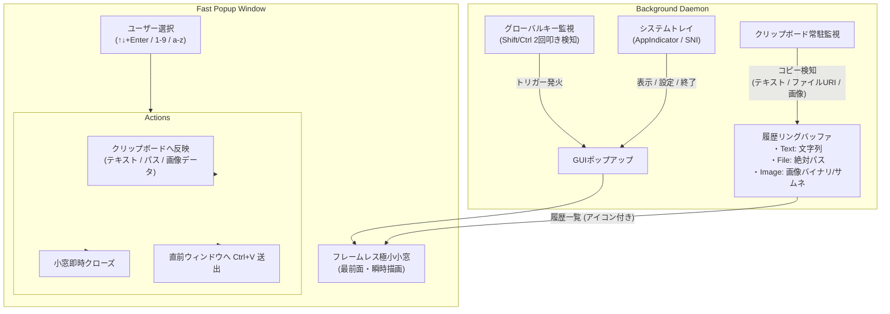

# Project "ClipOn": 超軽量Linuxクリップボードランチャー仕様書

- **プロジェクト名**: `ClipOn`
- **対象環境**: Ubuntu 22.04 LTS (Wayland / X11)
- **開発言語**: Rust (2021 edition)
- **作成日**: 2026-11-20
- **設計方針**: 贅肉ゼロ、動線至上主義、最速レスポンス、俺専用

---

## 1. コア要求・設計思想

### 1.1 背景
既存のLinux用クリップボードマネージャ（CopyQ等）は、余計な機能や多すぎる設定、環境抽象化の無理がたたり、UIが難解でショートカットキーの追従性やフォーカス復帰が著しく劣悪である。
Windowsにおける神ツール『Clibor』のような、**「思考のリズムを1ミリも邪魔しない直感的な動線」**をUbuntuネイティブで実現する。

### 1.2 コア動線（これ以外は一切不要）
1. **任意キーの連続叩き（ダブルタップ）で、0.001秒でポップアップ出現**
   - デフォルト: `Shift` キー2回（または `Ctrl` 2回、`Alt` 2回など設定可能）。
   - マウスカーソル直下またはアクティブ画面中央にフレームレス極小小窓が瞬時に浮上。
2. **直感的なキー選択**
   - `↑` `↓` キー移動 ＋ `Enter`。
   - または、各行に振られた数字（`1`〜`9`）／アルファベット（`a`〜`z`）の1キー打鍵。
3. **クリップボード転送 ＆ 直前ウィンドウへ自動ペースト**
   - 選択した瞬間にOSクリップボードへセット。
   - 直前のアクティブウィンドウへ即座に貼り付け（`Ctrl+V` キーストローク送出）。
   - 小窓は瞬時に非表示化（終了）。

---

## 2. 要件一覧

| # | 項目 | 仕様詳細 |
| :--- | :--- | :--- |
| **REQ-1** | **キーバインド任意設定（設定画面完備）** | ポップアップメニューの端（またはショートカット）から**シンプルな設定画面を開き、実際に押したキーをそのまま検知して呼び出しキーバインド（例: Shift 2回等）として登録可能**にする。<br/>※**色の変更やテーマ着せ替え等の無駄な装飾設定は一切排除**。キー設定と履歴件数、パス挿入モードのみに特化。 |
| **REQ-2** | **履歴保持と調整** | クリップボードのコピー履歴をメモリ上に保持（リングバッファ）。表示件数（例: 直近20〜50件）は設定可能。 |
| **REQ-3** | **キー選択** | `↑` / `↓` キー操作、および先頭のショートカット文字（`1`〜`9`, `a`〜`z`）の単打で選択。 |
| **REQ-4** | **転送 ＆ 貼り付け** | 選択決定と同時にクリップボードへ転送し、直前の入力欄へ貼り付け（キー送出）。貼り付けキー自体も変更可能（`Ctrl+v` / `Shift+Insert` 等）。 |
| **REQ-5** | **最速・無駄ゼロ** | 余計なクラウド同期、重厚な検索エンジン、タグ分けなどは一切排除。1フレーム（0.001秒台）で描画・終了する。 |
| **REQ-6** | **ファイル ＆ 画像対応（パス挿入連携）** | **テキストに加え、ファイルと画像も同一動線で透過的に扱う**。<br/>- **ファイルコピー時**: ファイラーからのコピーを検知。リストに `📄 filename` と表示し、選択時は「ファイルの絶対パス文字列（`/path/to/file`）」または「ファイル実体」をクリップボード転送。<br/>- **画像コピー時**: スクショ等のRAW画像バイナリを検知。リストに `🖼️ [画像 WxH]` と表示し、選択時はそのまま画像貼り付け、または一時保存した「画像ファイルパス」を挿入可能にする。 |
| **REQ-7** | **OS起動時連動・常駐設定（必須）** | 設定画面のチェックボックスひとつで、**Ubuntuログイン時の自動起動・バックグラウンド常駐（`~/.config/autostart/clipon.desktop` の自動生成/削除）**をオン・オフ可能にする。PC再起動後も意識せず常にシフト2回で呼び出せる状態を維持。 |
| **REQ-8** | **システムトレイアイコン常駐 ＆ 右クリックメニュー（表示・設定・終了）** | **Ubuntuトップバー（AppIndicator / StatusNotifierItem）にClipOnアイコンを常駐表示**。<br/>- **右クリックメニュー（または左クリック）**:<br/>  1. **表示 (Show)**: クリップボード履歴ポップアップをマウス位置に即時展開。<br/>  2. **設定 (Settings)**: キーバインド検出・自動起動設定画面を表示。<br/>  3. **終了 (Quit)**: ClipOnプロセスをクリーンに完全終了。 |

---

## 3. アーキテクチャ構成



---

## 4. 設定仕様 (`config.toml`)

```toml
[trigger]
# 呼び出しキー: "Shift", "Control", "Alt" など
key = "Shift"
# 判定タップ数（2 = ダブルタップ）
tap_count = 2
# ダブルタップ判定の最大間隔（ミリ秒）
interval_ms = 350

[history]
# 表示・保持する最大履歴件数
max_items = 25

[paste]
# 選択後の自動貼り付けを行うか
auto_paste = true
# 貼り付け時に送出するキー（デフォルト: Ctrl+V）
paste_key = "Ctrl+v"

[media]
# ファイルコピー選択時: "path"（絶対パス文字列を貼る）または "file"（ファイル実体）
file_mode = "path"
# 画像選択時: "image"（画像データ貼り付け）または "path"（一時保存してパス文字列を貼る）
image_mode = "image"
```
```

---

## 5. リリース・配布ポリシー

- **対象**: 純正 Ubuntu 22.04 LTS（Wayland / XWayland）
- **形態**: 単一バイナリ（`clipon`）＋ `config.toml` 1枚のみ。
- **サポート方針**: 「Works on my Ubuntu. No support.」余計な他OS・マイナーWM対応の泥沼に足を踏み入れず、自分の環境で最速・最高に動くことだけに全振りする。
